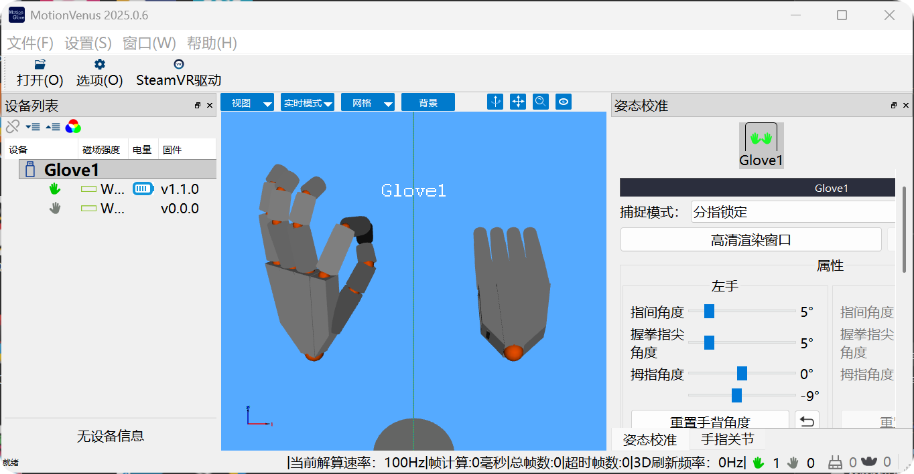
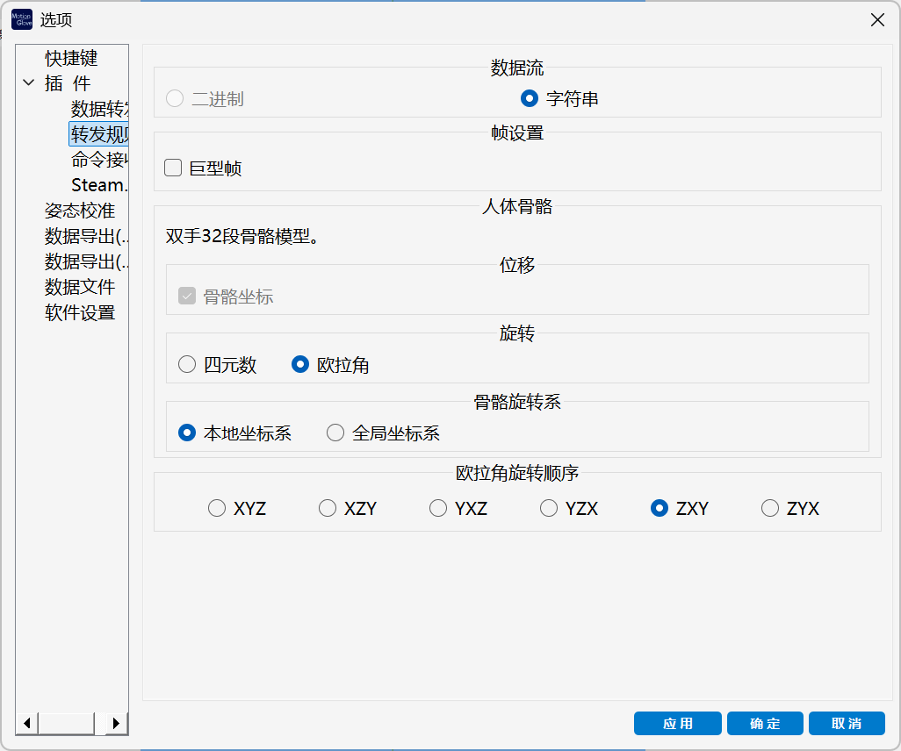
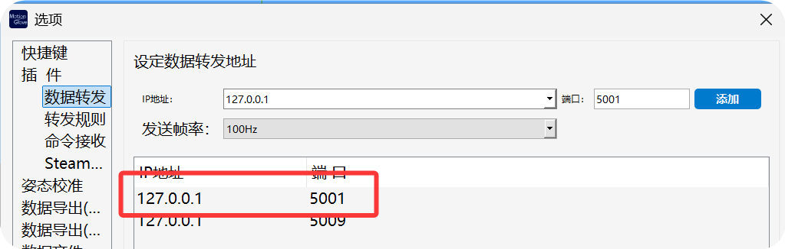
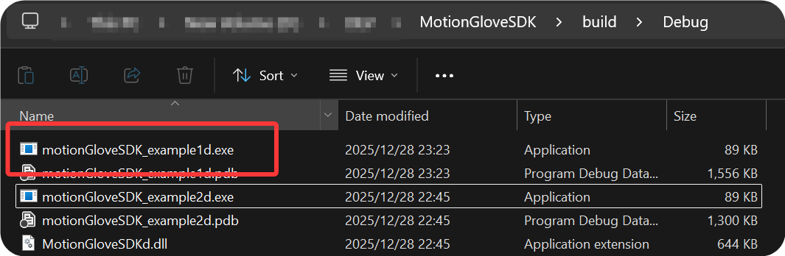
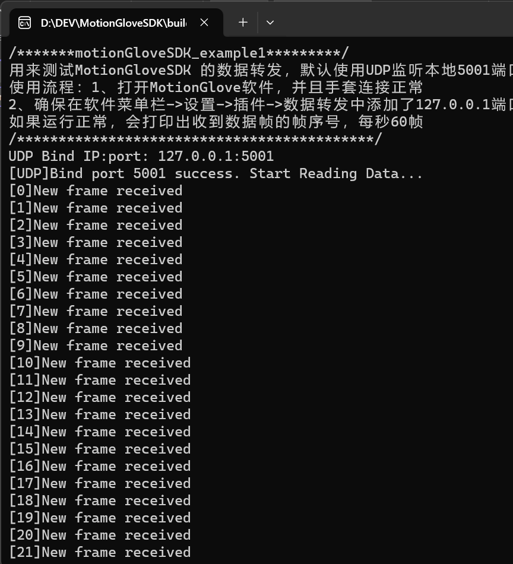
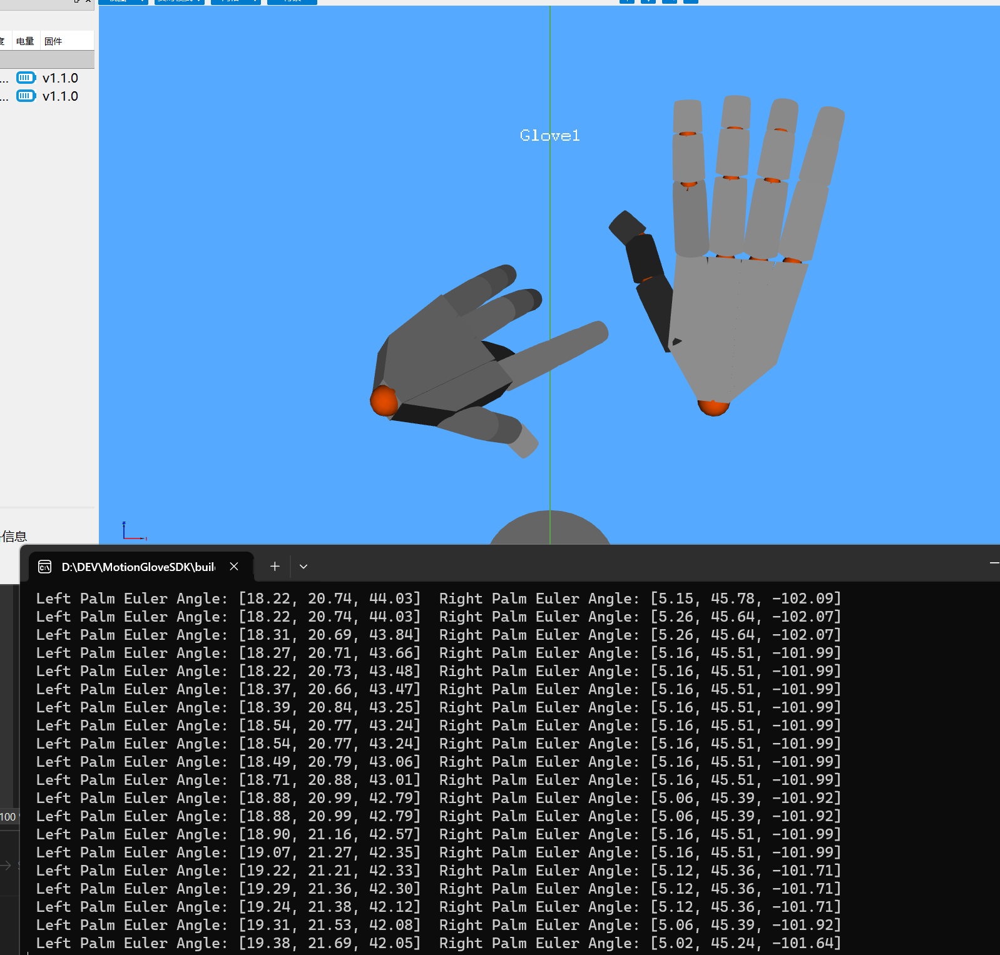
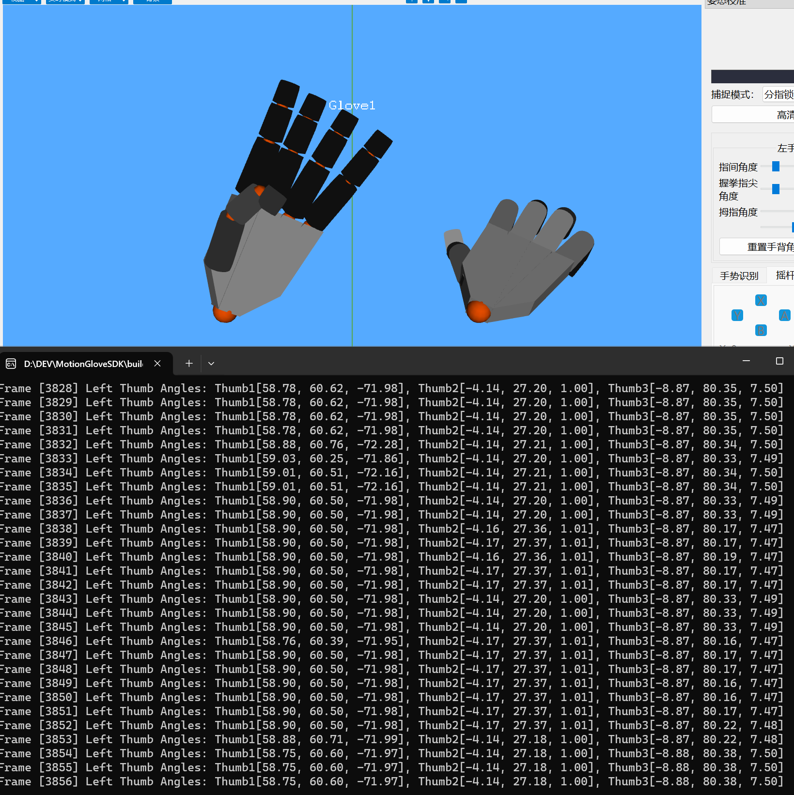
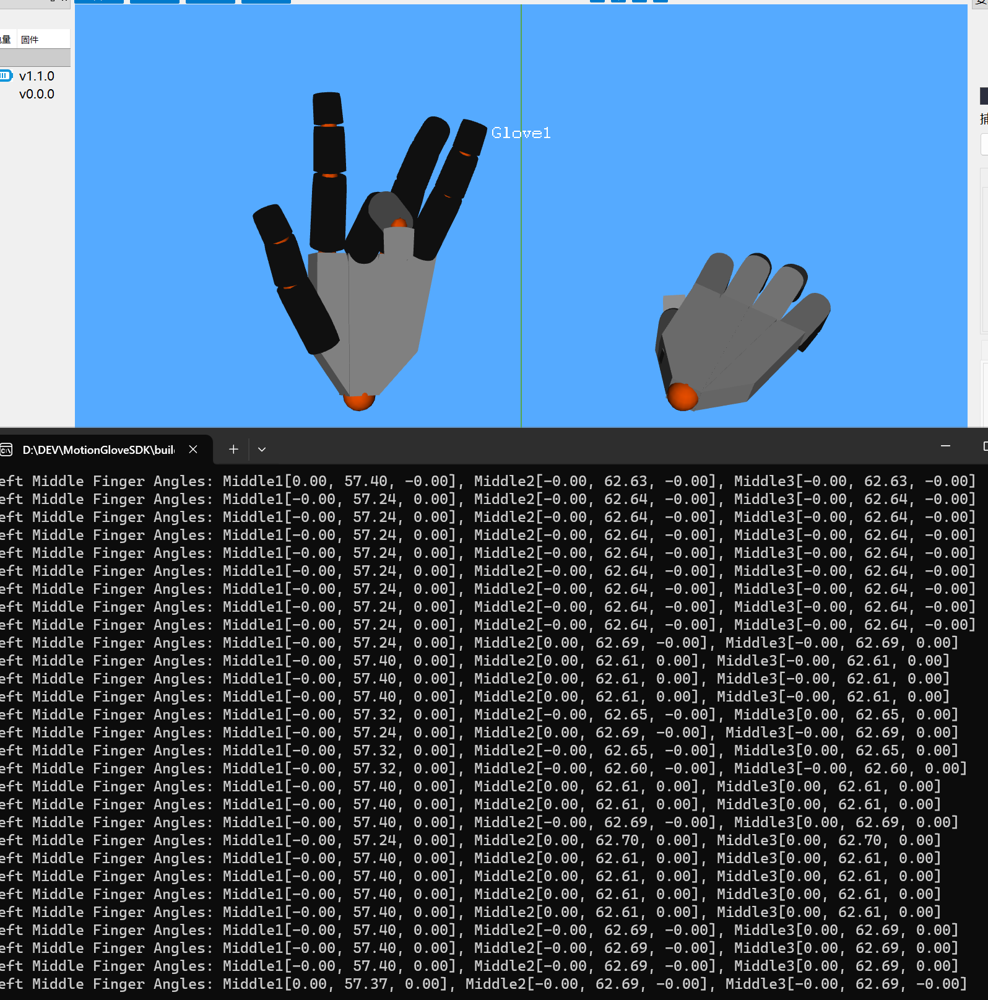

# MotionGloveSDK

## 工程结构

```
MotionGloveSDK/                        # 仓库根目录（只放源码、脚本、文档）
├── CMakeLists.txt                     # 顶层 CMake，构建 SDK 库 + 示例程序
├── .vscode/settings.json              # 唯一 IDE 配置来源：构建目录固定 out/build/vscode
├── LICENSE
├── README.md
│
├── MotionGloveSDK/                    # SDK 库子工程
│   ├── CMakeLists.txt                 # 编译为共享库 (DLL/SO)
│   ├── include/                       # 公开头文件
│   │   ├── motionGloveSDK.h
│   │   ├── motionGloveSDK_commonDef.h
│   │   ├── motionGloveSDK_HMAXGloveDef.h
│   │   └── motionGloveSDKDef.h
│   ├── inc/                           # 内部头文件
│   │   ├── decodeAsGloveCSV.h
│   │   ├── eulerToQuat.h
│   │   ├── motionGloveSdkHelper.h
│   │   ├── readWriteLock.h
│   │   └── resource.h
│   └── src/                           # 库源文件
│       ├── decodeAsGloveCSV.cpp
│       ├── eulerToQuat.cpp
│       ├── motionGloveSDK.cpp
│       └── motionGloveSdkHelper.cpp
│
├── MotionGloveSDK_examples/           # 示例程序（自动扫描 *example*.cpp）
│   └── src/
│       ├── motionGloveSDK_exampleCommon.h    # 示例共用：统一打印行首 [帧序号][骨骼段数]
│       ├── motionGloveSDK_example1.cpp
│       ├── motionGloveSDK_example2.cpp
│       ├── motionGloveSDK_example3.cpp
│       ├── motionGloveSDK_example4.cpp
│       ├── motionGloveSDK_example5.cpp
│       └── motionGloveSDK_example_vtk.cpp   # VTK 示例（默认编译，-DBUILD_VTK_EXAMPLE=OFF 关闭）
│
├── scripts/                           # 一键脚本入口（只认 out/ 下的路径）
│   ├── build.bat                      # 配置 + 编译 + 安装 + 汇总示例
│   ├── test.bat                       # ctest（构建树 out/build/tdd-tests）
│   ├── deploy.bat                     # 安装到 out/install + 汇总到 out/install_example
│   ├── package.bat                    # 源码分发包 → out/pack
│   └── gen_docs.bat                   # Doxygen HTML，告警日志 → out/doxygen
│
├── tools/                             # VTK 安装、打包、测试辅助脚本
│
├── out/                               # 全部生成物（git 忽略）
│   ├── build/x64-Debug/               # CLI 构建树（scripts/build.bat）
│   ├── build/x64-Release/
│   ├── build/vscode/                  # IDE 构建树（VSCode CMake Tools）
│   ├── build/tdd-tests/               # 单元测试构建树 + ctest 日志
│   ├── install/x64-Debug/             # 安装目录（库 + 头文件）
│   ├── install/x64-Release/
│   ├── install_example/x64-Debug/     # 示例 + 运行库，可直接运行
│   ├── install_example/x64-Release/
│   ├── pack/                          # 源码分发包 ZIP
│   └── doxygen/                       # Doxygen 告警日志
│
├── [Windows]build_vs2022.bat          # 兼容入口 → scripts/build.bat 2022
├── [Windows]build_vs2026.bat          # 兼容入口 → scripts/build.bat 2026
├── [Windows]git_pull_latest.cmd       # 拉取最新代码
├── [Windows]open_in_vscode.bat        # 用 VSCode 打开工程
├── [Linux]build.sh                    # 一键构建脚本（Linux/Ubuntu）
├── [Linux]git_pull_latest.sh          # 拉取最新代码
└── [Linux]open_in_vscode.sh           # 用 VSCode 打开工程
```

---

## 构建方法

### 快速构建（推荐）

直接运行对应平台的一键脚本，自动完成 Debug 和 Release 两套构建与安装，
全部产物落在 `out/`（截图/日志/zip 都不会再出现在仓库根目录）：

| 入口 | 说明 |
| --- | --- |
| `scripts\build.bat` | 主入口，`scripts\build.bat 2026` 可切 VS 2026，`scripts\build.bat 2022 Release` 只构建单一配置 |
| `scripts\test.bat` | 构建并运行单元测试（`out\build\tdd-tests`） |
| `scripts\deploy.bat` | 只做安装 + 示例汇总（`out\install`、`out\install_example`） |
| `scripts\package.bat` | 打源码分发包（`out\pack`） |
| `scripts\gen_docs.bat` | 生成 Doxygen HTML，告警日志写 `out\doxygen` |

根目录的 `[Windows]build_vs2022.bat` / `[Windows]build_vs2026.bat` 是双击用的兼容入口，
内部调用 `scripts\build.bat`。

**Windows（Visual Studio 2022）**

```
双击运行 [Windows]build_vs2022.bat
```

**Windows（Visual Studio 2026）**

```
双击运行 [Windows]build_vs2026.bat
```

**Linux / Ubuntu**

```bash
bash "[Linux]build.sh"
```

---

### 在 VSCode 里构建（CMake Tools）

`.vscode/settings.json` 已入库，把 IDE 的构建树固定到 `out/build/vscode`，与命令行脚本的
`out/build/x64-*` 分目录存放，避免两套生成器抢同一个 `CMakeCache.txt`：

```jsonc
{
  "cmake.buildDirectory": "${workspaceFolder}/out/build/vscode",
  "cmake.installPrefix": "${workspaceFolder}/out/install",
  "cmake.generator": "Visual Studio 17 2022",
  "cmake.platform": "x64"
}
```

要点：

- 改配置后执行命令面板 → `CMake: Delete Cache and Reconfigure`；状态栏的 `-B` 参数应为
  `out/build/vscode`。旧缓存（例如根目录 `build/`）可直接删掉。
- 需要 Debug/Release 时用状态栏 build variant，多配置生成器会忽略 `CMAKE_BUILD_TYPE`。
- 本工程的 IDE 树也使用 Visual Studio 生成器，因此 exe 在 `out/build/vscode/Debug/`
  （多配置生成器会自动追加配置子目录），命令行脚本的产物在 `out/build/x64-<配置>/<配置>/`。

---

### 手动构建

### Windows（Visual Studio 2022）

编译 Debug：

```console
cmake -S . -B out/build/x64-Debug -G "Visual Studio 17 2022" -A x64 -DCMAKE_CONFIGURATION_TYPES="Debug"
cmake --build out/build/x64-Debug --config Debug
cmake --install out/build/x64-Debug --config Debug --prefix out/install/x64-Debug
```

编译 Release：

```console
cmake -S . -B out/build/x64-Release -G "Visual Studio 17 2022" -A x64 -DCMAKE_CONFIGURATION_TYPES="Release"
cmake --build out/build/x64-Release --config Release
cmake --install out/build/x64-Release --config Release --prefix out/install/x64-Release
```

### Windows（Visual Studio 2026）

与 VS 2022 相同，将生成器改为 `"Visual Studio 18 2026"`：

```console
cmake -S . -B out/build/x64-Debug -G "Visual Studio 18 2026" -A x64 -DCMAKE_CONFIGURATION_TYPES="Debug"
cmake --build out/build/x64-Debug --config Debug
cmake --install out/build/x64-Debug --config Debug --prefix out/install/x64-Debug
```

> 同一个 `out/build/x64-*` 目录不能被 VS 2022 与 VS 2026 交替使用（`CMakeCache.txt` 写死了生成器，
> 换版本会报 `Does not match the generator used previously`）。切换 VS 版本前先删掉对应目录，
> 或让 `scripts\build.bat 2026` 使用另一台机器/另一份工作区。

### Linux / Ubuntu

编译 Debug：

```console
cmake -S . -B out/build/x64-Debug -DCMAKE_BUILD_TYPE=Debug
cmake --build out/build/x64-Debug
cmake --install out/build/x64-Debug --prefix out/install/x64-Debug
```

编译 Release：

```console
cmake -S . -B out/build/x64-Release -DCMAKE_BUILD_TYPE=Release
cmake --build out/build/x64-Release
cmake --install out/build/x64-Release --prefix out/install/x64-Release
```

### VTK 3D 可视化示例（motionGloveSDK_example_vtk）

该示例会在启动时打开一个 VTK 3D 窗口，并绑定本机全部网卡（`0.0.0.0`）的 UDP `5001` 端口接收手套骨骼数据（32 段）。
窗口里原点处绘制了三色坐标轴（X 红 / Y 绿 / Z 蓝）与 XZ 平面的地平面网格
（格距 0.1 m，范围 50 cm × 50 cm），作为位置参考。

**默认开启**：`BUILD_VTK_EXAMPLE` 默认为 `ON`，找到 VTK 9.x 就一起编译；
没装 VTK 时 CMake 会打印警告并自动跳过该示例，其余目标照常构建。
不想编译它可显式关闭：`-DBUILD_VTK_EXAMPLE=OFF`。

**一键脚本会自动处理 VTK**

`[Windows]build_vs2022.bat` / `[Windows]build_vs2026.bat` 会调用 [tools/setup_vtk.bat](./tools/setup_vtk.bat)：

1. 若环境变量 `VTK_DIR` 指向可用的 VTK，或仓库下 `third_party\vtk` 已装好 VTK，直接复用；
2. 否则用 conda-forge 的预编译 VTK（默认清华镜像）自动装到 `third_party\vtk`，
   期间会把 micromamba 下载到 `third_party\micromamba`、包缓存放在 `third_party\micromamba-root`；
3. 以 `-DBUILD_VTK_EXAMPLE=ON` 构建示例，并把 VTK 及其依赖的运行库 DLL
   （Debug/Release 输出目录各约 130 MB、58 个文件）自动复制到可执行文件同目录，
   因此 `motionGloveSDK_example_vtk.exe` **可直接双击运行**，无需设置 `PATH`。

若 VTK 获取或编译失败，脚本只跳过该示例、其余目标照常构建（fail-soft）。

**安装体积：默认只装用得到的部分**

conda-forge 的 `vtk` 元包会连带拉下 python 绑定、Qt6、boost 头文件、MKL、ffmpeg 等
（解包后约 **2.2 GB / 48000+ 文件**），而本示例只用 C++ 渲染那十来个模块。
`tools\setup_vtk.bat` 因此默认走**最小安装**：先按正常依赖关系装第三方运行库，
再用 `--no-deps` 只装 `vtk-base` + `vtk-io-ffmpeg` 本体，跳过上述用不到的部分：

| 安装方式 | 磁盘占用 | 文件数 | 首次下载 |
| --- | --- | --- | --- |
| 最小安装（默认） | 约 490 MB | 约 7200 | 约 120 MB |
| 完整安装（`VTK_FULL=1`） | 约 2.2 GB | 约 48000 | 约 450 MB |

两种装的配置、编译、运行结果完全一致（示例复制的 58 个运行库 DLL 一模一样）。
确实需要 python 绑定 / Qt 模块 / ffmpeg 编解码时，`set VTK_FULL=1` 后再跑脚本即可。

已装的是完整版、想换成最小版时，必须重装（conda 无法在原前缀上"减肥"）：

```console
set VTK_FORCE_REINSTALL=1
[Windows]build_vs2022.bat
```

`tools\setup_vtk.bat` 支持的环境变量（均可不设）：

| 变量                       | 说明                                                   |
| -------------------------- | ------------------------------------------------------ |
| `VTK_DIR`                | 已有 VTK 的 CMake 配置目录（含 `vtk-config.cmake`）    |
| `VTK_PREFIX`             | 自动安装 VTK 的位置，默认 `third_party\vtk`          |
| `VTK_CONDA_CHANNEL`      | conda 频道，默认 `https://mirrors.tuna.tsinghua.edu.cn/anaconda/cloud/conda-forge` |
| `VTK_FULL`               | 设为 `1` 时安装完整 `vtk` 元包（含 python 绑定 / Qt6 / ffmpeg） |
| `VTK_CONDA_SPEC`         | `VTK_FULL=1` 时安装的包，默认 `vtk`                    |
| `VTK_MINIMAL_SPEC`       | 最小安装的 VTK 包，默认 `vtk-base=9.7 vtk-io-ffmpeg=9.7` |
| `VTK_MINIMAL_DEPS`       | 最小安装的第三方依赖包清单（默认值与示例模块闭包对应，见脚本） |
| `VTK_FORCE_REINSTALL`    | 设为 `1` 时先删除 `third_party\vtk` 再安装（切换最小/完整安装用） |
| `VTK_SKIP_INSTALL`       | 设为 `1` 时只复用已装 VTK，不联网                     |
| `VTK_KEEP_PKG_CACHE`     | 设为 `1` 时保留 conda 包缓存（默认安装后清理，省数 GB） |
| `VTK_ALLOW_INSECURE_SSL` | 设为 `1` 时关闭下载时的 SSL 校验（证书吊销列表不可达的网络） |

之后构建脚本直接复用 `third_party\vtk`，不会重复下载。

**启动自检（`--self-test`）**

```console
motionGloveSDK_example_vtk.exe --self-test
```

只走完初始化（UDP 绑定 + VTK 场景搭建）就退出，不创建 OpenGL 上下文、不进事件循环，
便于在无显卡的机器/CI 上确认示例能正常启动；CI 会执行该自检并配合
`tools\test_vtk_example_launch.ps1` 做开窗测试。

**手动构建**

- VTK 默认就会编译，无需额外开关；只想编其它示例时才加 `-DBUILD_VTK_EXAMPLE=OFF`
- 如果 CMake 找不到 VTK（配置时会提示），请设置 `VTK_DIR` 指向 VTK 的 CMake 配置目录，
  并把 VTK 依赖库前缀加入 `CMAKE_PREFIX_PATH`（conda 布局下为 `<prefix>\Library`）

例如使用脚本装好的 VTK：

```console
cmake -S . -B out/build/x64-Release -G "Visual Studio 17 2022" -A x64 ^
      -DCMAKE_CONFIGURATION_TYPES="Release" ^
      "-DVTK_DIR=third_party/vtk/Library/lib/cmake/vtk-9.7" ^
      "-DCMAKE_PREFIX_PATH=third_party/vtk/Library"
cmake --build out/build/x64-Release --config Release
```

其他安装 VTK 的方式：

- 使用 vcpkg 安装（需要配置 toolchain file）
- 使用 VTK 官方源码包自行编译安装

> 说明：Windows 下 CMake 在 POST_BUILD 阶段会用
> [cmake/copy_runtime_dlls.cmake](./cmake/copy_runtime_dlls.cmake) 把示例依赖的
> 运行库 DLL 复制到 exe 同目录，手动构建同样可以直接双击运行。
>
> conda-forge 的 VTK 只有 Release 版，Debug 配置可以链接，但运行 Debug 版示例时
> 会混用 Release CRT，如遇异常请改用 Release 版示例。


---

## 构建产物

| 平台    | 库文件                                          | 安装目录                   |
| ------- | ----------------------------------------------- | -------------------------- |
| Windows | `MotionGloveSDK.dll` / `MotionGloveSDK.lib` | `out/install/x64-Debug/` |
| Linux   | `libMotionGloveSDK.so`                        | `out/install/x64-Debug/` |

示例可执行文件生成在 `out/build/x64-<配置>/<配置>/`（Visual Studio 多配置生成器会自动追加
配置子目录）；IDE 构建的示例在 `out/build/vscode/<配置>/`。

`cmake --install` 不传 `--prefix` 时默认装到 `out/install`（顶层 `CMakeLists.txt` 里的
`CMAKE_INSTALL_PREFIX_INITIALIZED_TO_DEFAULT` 判断），命令行脚本则按配置装到
`out/install/x64-<配置>/`。

一键构建脚本（`[Windows]build_vs2022.bat` / `[Windows]build_vs2026.bat`）还会把示例程序和
它们依赖的 DLL 汇总到 `out/install_example/`，按配置分开存放：

```
out/install_example/
├── x64-Debug/      # Debug 版示例 + MotionGloveSDK.dll + VTK 运行库（若启用 VTK）
└── x64-Release/    # Release 版示例 + 同上
```

这两个目录都是自带运行库的“开箱即用”副本，解压/拷贝到别处也能直接运行示例。

---

## 发布（打 tag 即发布 Release）

版本号唯一定义在 [MotionGloveSDK_examples/inc/motionGloveSDK_version.h](./MotionGloveSDK_examples/inc/motionGloveSDK_version.h)
的 `MOTIONGLOVE_EXAMPLE_VERSION_MAJOR/MINOR/PATCH`，CMake 用它设置工程版本，示例启动时也会打印
（如 `motionGloveSDK_example1 v0.2.1`）。

发版步骤：

```console
# 1. 修改版本头文件里的版本号并提交
git commit -am "release: v0.2.2"
# 2. 打标签并推送（标签必须与头文件版本一致）
git tag v0.2.2
git push origin main v0.2.2
```

推送 `v*` 标签会触发 [.github/workflows/release.yml](./.github/workflows/release.yml)：

1. 校验标签 `vX.Y.Z` 与版本头文件一致，不一致直接失败；
2. 在 `windows-latest` 上构建 Release（含 VTK 示例及其运行库）；
3. 把 `out/build/x64-Release/Release` 整个目录打成 `MotionGloveSDK_example_vX.Y.Z.zip`
   （顶层直接是 exe / dll，解压即可运行，约 29 MB）；
4. 创建 GitHub Release 并上传该 zip（重复推送同一标签会覆盖产物）。

---

## 源码分发包（分发给客户）

`scripts\package.bat`（逻辑在 [tools/package_source.ps1](./tools/package_source.ps1)）把当前
工作区打成 `out/pack/MotionGloveSDK_cpp_v<版本号>.zip`，版本号取自
[motionGloveSDK_version.h](./MotionGloveSDK_examples/inc/motionGloveSDK_version.h)，
也可命令行指定：`scripts\package.bat 0.2.2`。

压缩包内有一层顶层目录 `MotionGloveSDK_cpp_v<版本号>`，解压后可直接用
`[Windows]build_vs2022.bat` 等脚本构建。

**预编译产物（`preBuild/`）**：若打包前跑过一键构建脚本，`out/install` 与 `out/install_example`
会被原样放进包内，客户解压即得可直接运行的示例，不必自己装 VTK / 配工具链：

```
MotionGloveSDK_cpp_v<版本号>/
├── ...源码...
└── preBuild/
    ├── install/           # ← out/install：SDK 的 dll/lib/头文件
    │   ├── x64-Debug/
    │   └── x64-Release/
    └── install_example/   # ← out/install_example：示例 exe + 运行库（含 VTK）
        ├── x64-Debug/
        └── x64-Release/
```

两个目录不存在时会打印警告、照常出纯源码包；不想要预编译产物时加
`powershell -ExecutionPolicy Bypass -File tools\package_source.ps1 -SkipPreBuild`。

为保证客户拿到的是“只读源码”，打包时会剔除：

| 类别 | 内容 |
| --- | --- |
| 版本控制 | `.git/`（客户拿不到仓库地址与历史，无法 pull 你的代码）、`.gitignore` |
| git 操作脚本 | `[Windows]git_pull_latest.cmd`、`[Linux]git_pull_latest.sh`，以及 README 里对应的说明 |
| 内部资料 | `.github/`（CI 与 agent 配置）、`openspec/`、`docs/superpowers/`、`.vscode/` |
| 构建产物 | `out/`（`out/build`、`out/pack/staging` 暂存目录等；`out/install`、`out/install_example` 只以 `preBuild/` 形式进包）、`third_party/`（自动装的 VTK）、`docs/html`、`*.zip`、`*.log`；历史遗留的根目录 `build/` 若存在也一并剔除 |
| 本机专用 | `tools/autotools_env.bat`、打包脚本自身 |

脚本打完包会自检：一旦发现残留的 `.git` 目录、git 操作脚本或脚本里的
`git fetch/pull/clone` 命令，直接报错退出，避免内部信息被打进客户包。

> 打包请在“干净”的工作区执行（先提交改动），否则包里会带上未提交的文件。

---

## 注意事项

- Linux 脚本存储在 VMware hgfs 共享文件夹时，`make` 可能输出时钟偏差警告（`文件修改时间在未来`），这是宿主机与虚拟机时钟差异导致的，**不影响构建结果**，可忽略。
- Linux 脚本需要有执行权限：`chmod +x "[Linux]build.sh"`

---

## 软件配置与运行

### 1. 打开 MotionGlove

数据手套开机，首先打开 MotionGlove 数据手套客户端，确保客户端已连接数据手套并正常运行：



**网络配置：**

- **本机测试（Windows）**：在软件菜单栏 -> 设置 -> 插件 -> 数据转发 中添加 `127.0.0.1` 端口 `5000`（软件默认已添加）


- **局域网测试**：填入运行 MotionGloveSDK 的 PC 网络 IP 地址，端口填 SDK 监听的 `5001`；并确认该 PC 已放行入站 UDP（见"收不到数据时的排查"）。
- **Ubuntu 测试**：填入运行 MotionGloveSDK 的 PC 网络 IP 地址，确保与 Ubuntu 系统网络畅通。

转发规则如下：



---

### 2. 例程测试

> 以下以 Debug 版本为例讲解功能。

> **统一打印行首：** 例程 1~4 的每条逐帧输出都以 `[帧序号][骨骼段数]` 开头，例如
> `[1234][42] Left Palm Euler Angle: ...`。第一个中括号是当前帧的帧序号（取自帧头
> `hdr.frameNumber`），第二个中括号是本帧的骨骼段数，取值为 `32`、`42` 或 `OpenXR`。

### 2.1 motionGloveSDK_example1

**测试目的：** 测试是否接收到了 MotionGloveSDK 的数据转发，默认使用 UDP 监听本机全部网卡（`0.0.0.0`）的 `5001` 端口。

**使用流程：**

1. 打开 MotionGlove 软件，并且手套连接正常。
2. 确保在软件菜单栏 -> 设置 -> 插件 -> 数据转发 中添加了 `127.0.0.1` 端口 `5000`（软件默认已添加）。



如果运行正常，会打印出收到数据帧的帧序号，每秒 60 帧，行首形如 `[1234][42] New frame received`。

3. 双击运行编译输出目录中的 `motionGloveSDK_example1d.exe`。



打印 `New frame received` 代表收到了转发的数据。



---

### 2.2 motionGloveSDK_example2

**测试目的：** 测试左右手手背的角度，以及左手拇指第 3 段与拇指末端的位置和角度。

手背角度所在的坐标系为 MotionGlove 软件 3D 窗口左下角标识的坐标系。



**数据示例（最后一行输出）：**

```
[1234][42] Left Palm Euler Angle: [1.25, -2.30, 8.90]  Right Palm Euler Angle: [0.90, 1.10, -3.40]
[1234][42] Left Thumb3 Pos(m): [0.0190, 0.0380, 0.0570] Euler(deg): [12.50, 1.00, 2.00] Left Thumb3End Pos(m): [0.0190, 0.0380, 0.0600] Euler(deg): [12.50, 1.00, 2.00]
```

- 每帧两行，行首都是统一的 `[帧序号][骨骼段数]`；
- 位置 `Pos` 单位米，角度 `Euler` 单位度，姿态参考系与手背角度一致；
- 拇指末端（`Thumb3End`）只在 42 段骨骼格式中存在；32 段格式下该列打印 `N/A`。

---

### 2.3 motionGloveSDK_example3

**测试目的：** 测试左手拇指三段骨骼的角度。

| 骨骼段  | 角度参考            |
| ------- | ------------------- |
| 第 1 段 | 相对于手背的角度    |
| 第 2 段 | 相对于第 1 段的角度 |
| 第 3 段 | 相对于第 2 段的角度 |



**数据示例（最后一行输出）：**

```
[1234][42] Left Thumb Angles: Thumb1[58.75, 60.60, -71.97], Thumb2[-4.14, 27.18, 1.00], Thumb3[-8.88, 80.38, 7.50]
```

- **第 1 段**：相对于手背的角度，是所有手指里角度最复杂的一段。
- **第 2 段**：由于指关节自由度限制，可忽略 XZ 轴，只关心 Y 轴的 27.18°。
- **第 3 段**：由于指关节自由度限制，可忽略 XZ 轴，只关心 Y 轴的 80.38°。

> 整体弯曲角度 = 第 2 段 + 第 3 段 Y 轴之和：27.18 + 80.38 = **107.56°**

---

### 2.4 motionGloveSDK_example4

**测试目的：** 测试左手中指三段骨骼的角度。

| 骨骼段  | 角度参考            |
| ------- | ------------------- |
| 第 1 段 | 相对于手背的角度    |
| 第 2 段 | 相对于第 1 段的角度 |
| 第 3 段 | 相对于第 2 段的角度 |



**数据示例（最后一行输出）：**

```
[1234][42] Left Middle Finger Angles: Middle1[0.00, 57.37, 0.00], Middle2[-0.00, 62.69, -0.00], Middle3[-0.00, 62.69, -0.00]
```

- **第 1 段**：由于指关节自由度限制，可忽略 XZ 轴，只关心 Y 轴的 57.37°。
- **第 2 段**：由于指关节自由度限制，可忽略 XZ 轴，只关心 Y 轴的 62.69°。
- **第 3 段**：由于指关节自由度限制，可忽略 XZ 轴，只关心 Y 轴的 62.69°。

> 整体弯曲角度 = 三段 Y 轴之和：57.37 + 62.69 + 62.69 = **182.75°**

食指、中指、无名指、小指均可按照上述方法计算相对角度。

## 收不到数据时的排查（局域网部署）

SDK 绑定的是 `0.0.0.0:<端口>`（本机全部网卡），所以"收不到"通常不是绑定地址的问题。按下面顺序定位：

1. **确认绑定成功**：程序启动应打印 `Bind port 5001 success`；若提示
   `Bind local port 5001 failed!`，说明端口已被占用（多为上一次实例没退出），先结束占用进程。
2. **确认报文确实到达本机协议栈**：
   - 在目标电脑执行 `netstat -ano -p UDP | findstr :5001`，应看到 `0.0.0.0:5001` 及进程 PID；
   - 在 Wireshark 里检查数据包的 **Destination IP / MAC 是不是本机**。抓包网卡的混杂模式会显示
     "发给别的机器"的包，这类包协议栈会直接丢弃，SDK 永远收不到。
3. **Windows 防火墙（现场最常见原因）**：Wireshark（Npcap）在防火墙之前抓包，报文被防火墙丢弃时照样能看到，
   而 SDK 的 socket 一个包都收不到（诊断日志里没有 `[info]`）。
   - 一键放行（管理员命令行）：`tools\add_firewall_rule.bat 5001`
   - 等价手工命令：

     ```bat
     netsh advfirewall firewall add rule name="MotionGloveSDK UDP 5001" dir=in action=allow protocol=UDP localport=5001 remoteip=LocalSubnet
     ```

     需要允许任意来源（例如跨网段）时，把 `remoteip=LocalSubnet` 换成 `remoteip=any`，
     或执行 `tools\add_firewall_rule.bat 5001 any`。
   - 首次运行时弹出的"允许访问"要勾选专用/公用网络；
   - 若公司策略禁止改防火墙，可临时关闭防火墙复测：能收到即确认是此原因。
4. **打开 SDK 收包诊断**（环境变量，默认关闭）后运行程序：

   ```bat
   set MOTIONGLOVE_SDK_UDP_DEBUG=1
   ```

   - 打印 `[info] UDP datagram received: ... head="Glove1 ..."`：报文已进入 socket；
   - 没有这一行：报文没到 socket，回到第 2、3 步；
   - 打印 `[warn] UDP datagram ignored (non-CSV / non-glove CSV) ... head="..."`：报文到了但格式不被识别。
     帧必须以 `Glove` 开头（上位机的演员名为空时整帧以空格开头，会被丢弃），检查数据转发规则。
